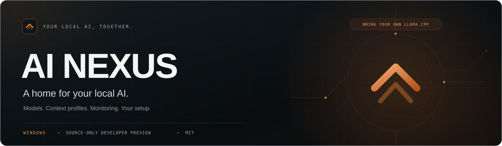
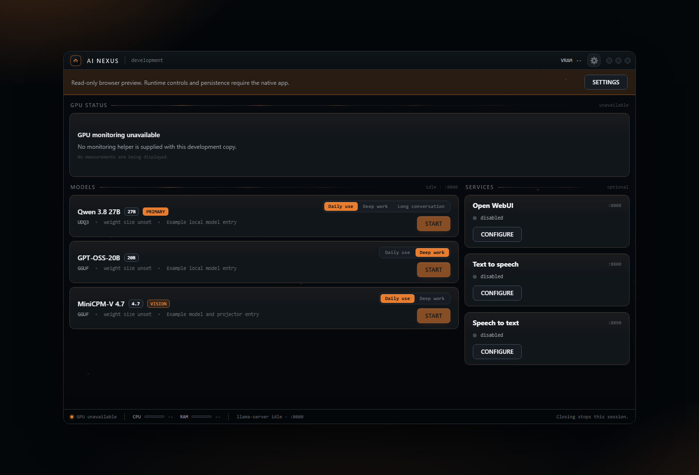
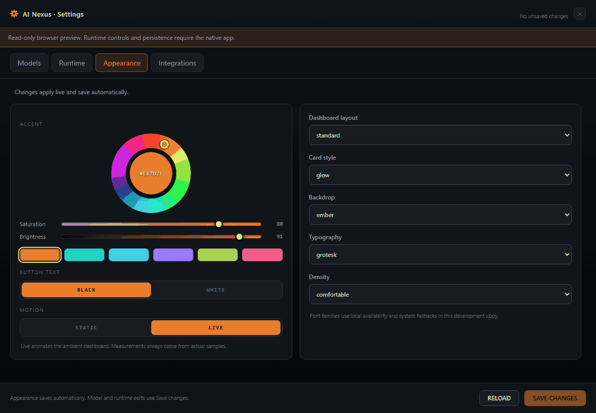
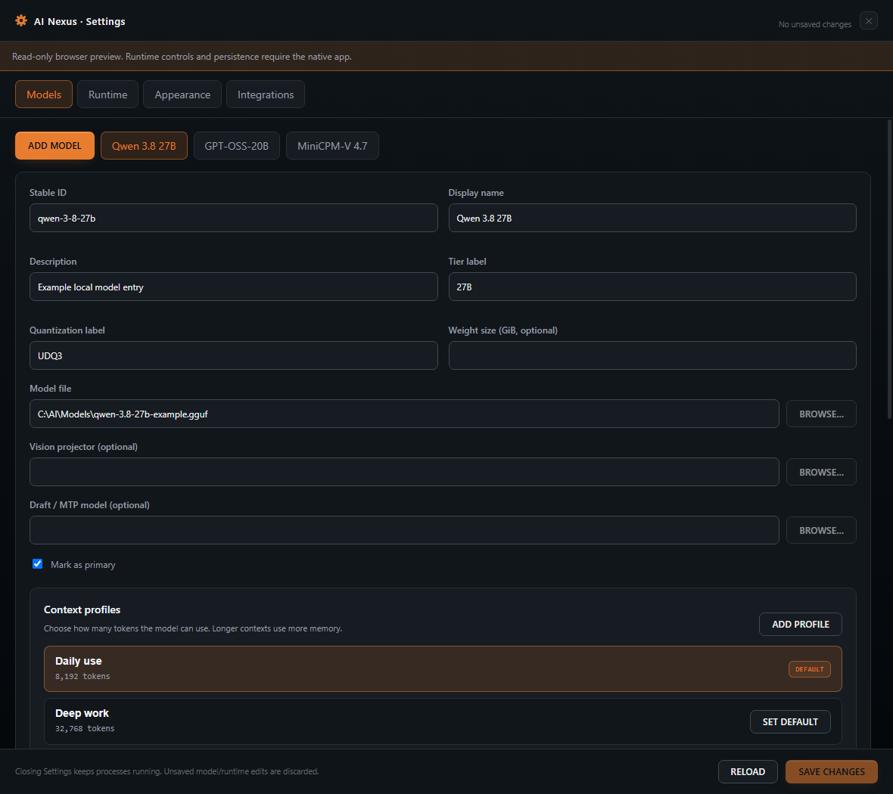
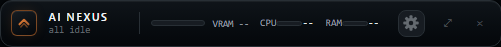

  

  <strong>A desktop dashboard for your models, your llama.cpp build and your way of working.</strong>

  <a href="#get-started">Get started</a> ·
  <a href="#a-look-inside">Take a look</a> ·
  <a href="#monitoring">Set up monitoring</a> ·
  <a href="#current-status">Preview status</a> ·
  <a href="#contributing">Contribute</a>

> [!IMPORTANT]
> **This is a source-only developer preview for Windows.** You build the app and
> supply your inference runtime and model files. There is no installer or bundled
> AMD monitoring helper. CUDA, HIP and Vulkan are backend selection labels;
> real inference compatibility is still unverified for this preview.

## A look inside

  

  Actual UI in the read-only browser preview. Model names are examples; file paths are placeholders.
  No models or optional services are running; unavailable measurements stay unavailable.

AI Nexus brings your local setup into one place. Add the models you want to use,
give them readable context profiles, and keep the dashboard nearby—or shrink it
to the compact HUD.

| Make room for your workflow | Make it feel like yours |
| --- | --- |
| **Your model shelf.** Add, edit and remove entries without deleting model files. | **Live appearance controls.** Choose an accent, backdrop, layout, density and card style. |
| **Named context profiles.** Keep everyday settings handy and put advanced splits/cache options where you need them. | **Motion you control.** Keep the ambient animation or switch to static mode. Decorative effects never stand in for measurements. |
| **A separate Settings window.** Browse for your executable, models and auxiliary files, with a searchable flag guide. | **A compact HUD.** Keep the launcher close without keeping the full dashboard open. |
| **System readouts.** Native CPU/RAM samples and an optional NVIDIA/AMD GPU-monitoring interface. | **Optional services.** Configure your own Open WebUI, TTS/STT and OpenCode integrations when you need them. |

### Make it yours

  

  A short loop of the real appearance controls. Browser-preview changes are temporary;
  the native app previews and saves appearance separately from model/runtime drafts.

Prefer a still image? [Open the Appearance screenshot](docs/media/settings-appearance.png).

<strong>See model entries and context profiles</strong>

Example paths and names only. Browse and persistence require the native Windows app.

<strong>See the compact HUD</strong>

The native HUD keeps this session running while the full dashboard is tucked away.
Closing the app ends the session.

[How these visuals were captured](docs/media/README.md)

## Get started

### 1. Build the Windows app

Supply Node.js/npm, a Rust MSVC toolchain, Microsoft C++ Build Tools with a Windows
SDK, and Microsoft Edge WebView2.

<strong>Tool versions used during preparation</strong>

Preparation used Node.js 24.15.0, Rust 1.96.0, Babel 7.29.7, Tauri CLI 2.11.2 and
React/React DOM 18.3.1. Rust 1.88 is the manifest's declared minimum, not a verified
minimum. Other operating systems and clean-Windows setup remain unverified.

Open PowerShell in the checkout directory. These first-time commands acquire
development packages when you choose to allow downloads. They do not acquire
models or inference services, and were not executed during source preparation.

~~~powershell
npm ci --ignore-scripts --no-audit --no-fund
cargo fetch --locked --manifest-path src-tauri/Cargo.toml --target x86_64-pc-windows-msvc
cargo fetch --locked --manifest-path tests/native-core/Cargo.toml --target x86_64-pc-windows-msvc
~~~

After supplying dependencies, build and run offline:

~~~powershell
npm run build:frontend
cargo build --offline --locked --manifest-path src-tauri/Cargo.toml --target-dir .build/desktop
& '.\.build\desktop\debug\ai-nexus-dev.exe'
~~~

Lockfiles record package versions, registry locations and integrity/checksum data;
integrity is not proof of safety. The npm command disables install scripts.
Its optional macOS-only fsevents script is unnecessary on Windows. Keep
dependency acquisition separate from ordinary offline rebuilding.

### 2. Bring your runtime and first model

The app opens with an empty roster, unset runtime/helper paths, loopback ports,
and disabled optional services and OpenCode sync.

1. In **Settings → Runtime**, choose CUDA, HIP or Vulkan for the llama.cpp build
   you supply. Browse to llama-server and keep its required runtime libraries
   beside it.
2. In **Models**, add a unique ID/display name and Browse to a GGUF. Add a
   projector or draft file only when your model/build requires it.
3. Add named context profiles from presets or a custom token count. Blank GPU
   settings defer to the backend; device identifiers and splits must match your
   actual build. Advanced options include splits and cache settings.
4. **Save changes**, then explicitly press **START** on the dashboard.

Flags have an add/remove editor, searchable guidance and a link to the official
llama.cpp reference. Settings shows a quoted help command for your executable;
it never runs that command automatically. Flags vary between builds.

There is no automatic model downloading or GPU tuning. Removing an entry changes
configuration only, including its optional OpenCode mapping; model and auxiliary
files stay on disk. Stop an active entry before editing/removing it. Browse fills
a draft without running or saving the selected file.

### 3. Settle into your setup

Appearance previews live and saves separately. Model/runtime/integration drafts
use **Save changes**. Closing Settings flushes appearance, discards other unsaved
drafts and leaves the dashboard and this session's processes running.

Minimize or use the HUD to keep the session running. **Closing the dashboard stops
the processes started by this session and exits.** Shutdown currently forces
termination rather than using a service-specific graceful shutdown.

<strong>Configuration, recovery and development commands</strong>

One configuration drives model cards, contexts, runtime arguments, ports,
appearance, monitoring and integrations. See the
[safe schema example](config/launcher.config.example.json).

Configuration and WebView data live under .ai-nexus-data in the checkout used at
build time. Keep that checkout when running its development executable; moving
the executable alone is not a supported portable installation. Use one app
instance per checkout. Installed/portable storage and cross-process writer
locking are pending. AI_NEXUS_DATA_DIR may point only to an absolute directory
inside this checkout.

Missing configuration opens an empty setup state. Invalid configuration is
reported without silently replacing it. Saves validate IDs, paths, contexts,
splits, flags and enabled integrations, and retain launcher.config.previous.json.
Repair/recovery also preserves invalid/replaced configuration. No recovery
operation deletes models.

Context names are separate from stable IDs. The reply limit affects OpenCode
sync only, not llama-server generation limits. Readiness requires /health success
and the expected /v1/models alias within a fixed 120-second startup deadline.
Private Windows job handles retain worker ownership after parent exit;
unregistered processes are not assigned to those jobs.

npm run dev starts the development watch workflow. Its Tauri wrapper keeps
Cargo offline and output under .build/desktop. npm run preview builds the
frontend and serves a read-only browser view at http://127.0.0.1:5174; it cannot
save settings, run processes or invent telemetry.

No private launcher installation is required. The optional AI_NEXUS_BUILD_TOOLS
override can point to an existing folder with matching npm build dependencies.
It is build tooling, not launcher configuration.

## Monitoring

CPU/RAM use native system samples. GPU cards and the HUD are retained, but GPU
monitoring starts as unavailable until you configure a supported provider.
Failed polls clear readings; an unsupported measurement appears as `--`, never
as a made-up zero. Ambient animation is decorative.

Monitoring is separate from CUDA/HIP/Vulkan inference selection and does not
require starting a model or an optional service. Provider/GPU compatibility is
unverified in this preview. CPU/RAM and the rest of the launcher remain available
when GPU monitoring is disabled.

<strong>NVIDIA — use your installed nvidia-smi</strong>

You need a working NVIDIA driver/tooling installation with `nvidia-smi.exe`.
This path does not need a custom helper or the CUDA Toolkit.

1. Find your installed executable. If it is on PATH, this optional PowerShell
   command shows its full path:

   ~~~powershell
   Get-Command nvidia-smi.exe -ErrorAction SilentlyContinue | Select-Object -ExpandProperty Source
   ~~~

   An empty result means the command did not find it on PATH. Check your
   installed NVIDIA tooling for its location; AI Nexus does not install it.
2. Open **Settings → Runtime → GPU monitoring**. Choose `nvidia-smi` as the
   Monitoring source, enter its full path, then **Save changes**.
3. Check the dashboard for measurements your GPU supports. To check the tool
   independently, use the [read-only query](docs/GPU_MONITORING.md#nvidia-use-an-existing-nvidia-smi-installation).

See [NVIDIA's official reference](https://docs.nvidia.com/deploy/nvidia-smi/)
for supported queries.

<strong>AMD — connect an ADLX-based adapter</strong>

AMD monitoring needs a compatible ADLX-based adapter: a small program that reads
GPU measurements and returns the format AI Nexus understands. This preview
does not include one. Preparing it is a developer step; this outline is guidance,
not a tested start-to-finish build recipe. With a compatible helper, start at step 4.

1. Start with the [official ADLX SDK repository](https://github.com/GPUOpen-LibrariesAndSDKs/ADLX)
   and [AMD's getting-started guide](https://gpuopen.com/manuals/adlx/programming-with-adlx/adlx-programming-guide/quick-start/).
   Follow AMD's Windows C/C++ prerequisites and the SDK terms that accompany
   the version you use.
2. Use AMD's performance-monitoring examples as a starting point for reading
   supported measurements. Use monitoring examples, not GPU tuning or stress tests.
3. Adapt the program to [AI Nexus's helper protocol](docs/MONITOR_PROTOCOL.md#amd-process-and-response-contract),
   then build it as a Windows executable. It must accept `--serve`, wait for
   a `poll` request and return one line of GPU readings as JSON. Installing
   the SDK or building an unchanged AMD sample does not complete this adapter step.
4. Open **Settings → Runtime → GPU monitoring**. Choose `amd-adlx`, enter
   the full helper executable path, then **Save changes**.
5. Check the dashboard. A helper that cannot start, returns the wrong format or
   takes too long to reply leaves monitoring unavailable.

<strong>If readings are missing</strong>

Check the saved provider and full executable path. For NVIDIA, try the read-only
query above. For AMD, check response format and timing against the protocol.
There is no need to change drivers, permissions or tuning settings to follow
these walkthroughs.

See the [monitoring guide](docs/GPU_MONITORING.md) for troubleshooting and the
[third-party notices](THIRD_PARTY_NOTICES.md) for separate vendor terms.

## Optional integrations

Open WebUI, TTS/STT and OpenCode synchronization are disabled initially.
Configuration currently uses advanced JSON for service commands and OpenCode
mappings. Services need explicit enablement, distinct loopback ports, matching
health URLs and tokenized executable commands. Enablement does not start them.
Their implementations, dependencies and assets are user-supplied.

OpenCode sync updates only its separately configured JSON, keeps a backup and
reports partial sync failures as warnings after inference readiness.

## Current status

| Checked in preparation | Still needs real-world validation |
| --- | --- |
| Frontend and offline native development builds | Clean-Windows setup and first-time dependency acquisition |
| 18 JavaScript checks, including mocked IPC; 21 native core checks | Real CUDA/HIP/Vulkan inference and GPU/provider compatibility |
| 26 native dummy-server lifecycle checks, including switching, cancellation and shutdown | Optional services, OpenCode end-to-end behavior and graceful backend shutdown |
| Read-only documentation visuals, with illustrative model entries | Native picker Open-button selection and wider display-scale coverage |

Build/test results are historical preparation evidence, not claims of new tests
run for this README. See [validation evidence and limits](docs/VALIDATION.md).
This preview does not include an installer, inference runtime, model, voice
asset, AMD adapter, SDK or driver. No font files are bundled; system fallbacks
can change typography.

## Contributing

Bug reports and focused improvements are welcome. Start with
[CONTRIBUTING.md](CONTRIBUTING.md) and the [PR template](.github/PULL_REQUEST_TEMPLATE.md).
Use redacted examples and temporary fixtures. Preserve the dashboard, themes,
typography treatment and motion controls.

~~~powershell
node --test tests/config-ui.test.cjs
cargo test --offline --locked --manifest-path tests/native-core/Cargo.toml --target-dir .build/native-core
~~~

The [optional native lifecycle suite](tests/lifecycle/README.md) uses a compiled
dummy HTTP server and plain-text placeholders, not real inference or services.

<strong>Source integrity and licensing</strong>

[SOURCE_MANIFEST.json](SOURCE_MANIFEST.json) records SHA-256 hashes for the
publication files except itself. The self-exclusion is explicit: embedding its
hash would change the manifest being hashed. Hashes cover ordinary file
contents; Windows alternate streams were checked separately during sanitation.
The manifest is an integrity snapshot, not a signature or redistribution approval.
Update it when source, documentation or media changes.

Original project code and original README artwork are [MIT licensed](LICENSE).
Included third-party code retains its own notices and terms; see
[THIRD_PARTY_NOTICES.md](THIRD_PARTY_NOTICES.md). User-supplied runtimes, models,
monitoring tools and services have separate terms. See the
[sanitation checks and limits](docs/VALIDATION.md#sanitation-and-source-provenance).

Made by iAmBoosted · Copyright © 2026 iAmBoosted

